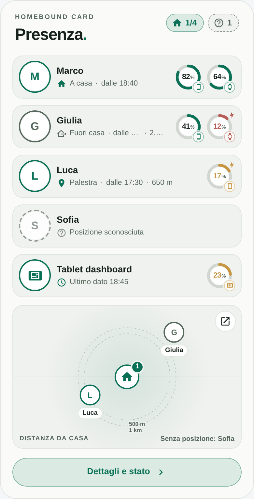
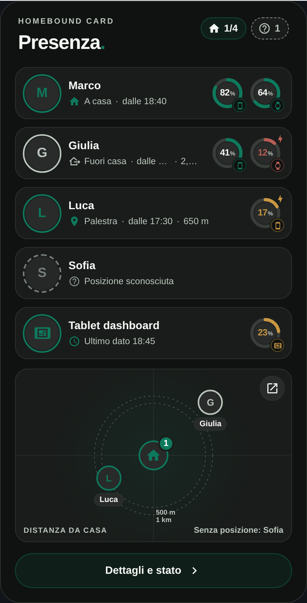
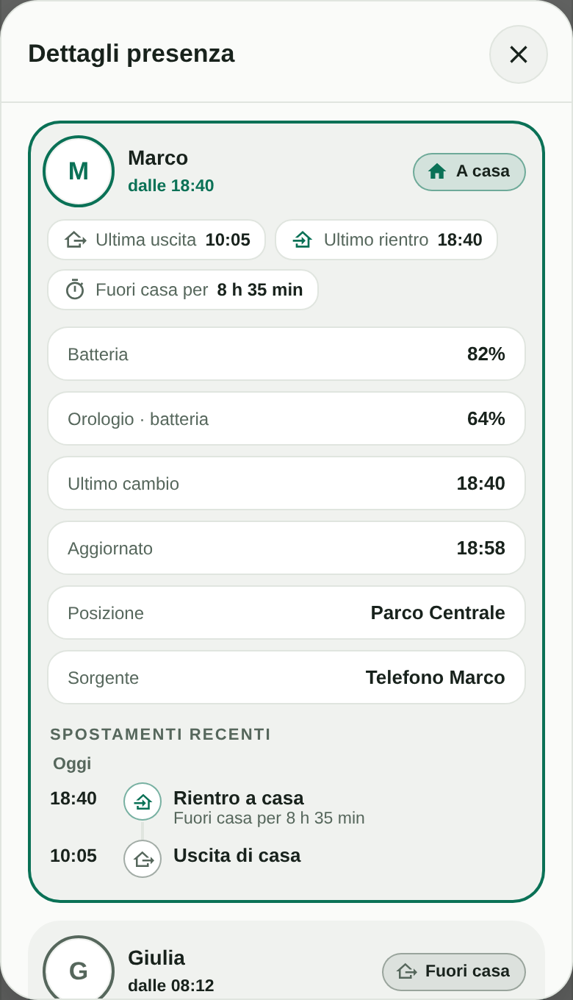

# Homebound Card

[](#marketplace-recommended)
[](https://github.com/luigi-regolo/homebound-card/releases/latest)
[](LICENSE)
[](https://github.com/luigi-regolo/homebound-card/stargazers)

## Overview

**Homebound Card** is a custom presence card for Home Assistant dashboards, designed with a minimalist interface inspired by the Edera Light and Dark visual styles.

It shows who is home, when each person last changed state, and the battery level of their phone and watch. Household devices, such as a dashboard tablet, can be listed in the same card. A details popup provides recent history and a simplified map.

The card uses entities already available in Home Assistant. It does not require a dedicated account, external map services, or additional cloud services.

## Preview







*Previews use fictional demo data. The interface text is currently in Italian.*

## Features

- **Presence at a glance:** Home, away, a named zone, or unknown, based on `person` and `device_tracker` entities. An unknown or unavailable state is shown in grey and is never reported as "away".
- **Last state change:** When each person arrived or left, with a summary counter in the header.
- **Battery gauges:** Phone and watch battery levels, with a charging indicator shown only while charging.
- **Household devices:** Optional rows for devices such as a dashboard tablet, shown after the people, with the time of the last received data.
- **Recent history:** A details popup with departures and returns over 24 hours, 3 days, or 7 days, based on the Home Assistant Recorder.
- **Simplified map:** Distance and direction from home, drawn locally without external map services.
- **Edera appearance:** Automatic, Light, and Dark themes with Home Assistant Material Design Icons.
- **Visual configuration:** Entity selection and settings through the dashboard editor.
- **Responsive layout:** A compact interface for desktop, smartphone, and tablet dashboards.

The card is read-only: it does not send commands to Home Assistant. Missing data is not estimated or replaced with invented values.

## Installation

### Marketplace (Recommended)

For Home Assistant 2026.11 and later.

1. Open **Settings → Marketplace** in Home Assistant.
2. Search for **Homebound Card**.
3. Select it and install it.
4. Reload your dashboard if necessary.
5. Add **Homebound Card** to your dashboard and configure it using the visual editor.

[](https://my.home-assistant.io/redirect/marketplace_repository/?owner=luigi-regolo&repository=homebound-card&category=plugin)

### HACS

For Home Assistant versions before 2026.11.

1. Open **HACS** in Home Assistant.
2. Search for **Homebound Card**.
3. Select it and click **Download**.
4. Reload your dashboard if necessary.
5. Add **Homebound Card** to your dashboard and configure it using the visual editor.

[](https://my.home-assistant.io/redirect/hacs_repository/?owner=luigi-regolo&repository=homebound-card&category=plugin)

### Alternative: HACS custom repository

1. Open **HACS** in Home Assistant and select **Custom repositories** from the menu.
2. Enter `https://github.com/luigi-regolo/homebound-card`.
3. Select **Dashboard** as the repository type and add it.
4. Find **Homebound Card** in HACS and click **Download**.

### Manual installation

1. Download `homebound-card.js` from the latest GitHub Release.
2. Copy it to the `www` directory of your Home Assistant configuration.
3. Open **Settings → Dashboards → Resources** in Home Assistant.
4. Add the following resource:

   `/local/homebound-card.js`

5. Select **JavaScript module** as the resource type.
6. Reload the dashboard and add the custom card.

If the `www` directory was just created, Home Assistant may need to be restarted before the file becomes accessible.

## Configuration and Usage

### Visual editor

Open a dashboard in edit mode, add **Homebound Card**, and configure the available settings.

The editor includes three sections:

- **People:** Add people (`person.*` or `device_tracker.*`) and, optionally, household devices. Each item can have a custom name and optional battery, charging, and location entities.
- **Appearance:** Header label, title, Edera theme, simplified map, and battery display.
- **Advanced:** Default history period and map panel path.

### Example YAML configuration

```yaml
type: custom:homebound-card
title: Presenza
people:
  - entity: person.example_one
    battery_entity: sensor.example_phone_battery_level
    charging_entity: binary_sensor.example_phone_charging
    location_entity: sensor.example_phone_geocoded_location
    watch_battery_entity: sensor.example_watch_battery
    watch_charging_entity: binary_sensor.example_watch_charging
  - entity: person.example_two
devices:
  - entity: sensor.example_tablet_battery_level
    type: tablet
    charging_entity: binary_sensor.example_tablet_charging
```

Replace the example entities with existing entities in your Home Assistant installation.

### Configuration options

| Option | Description |
|---|---|
| `people` | List of people. Each item is an entity ID or an object (see below). |
| `devices` | Optional list of household devices (see below). |
| `title` | Main card title. |
| `eyebrow` | Small header label above the title. |
| `show_eyebrow` | Shows or hides the header label. Enabled by default. |
| `show_title` | Shows or hides the title. Enabled by default. |
| `theme_mode` | `auto`, `light`, or `dark`. |
| `show_map` | Shows the simplified map. Enabled by default. |
| `show_battery` | Shows phone and watch battery for people. Enabled by default. |
| `history_hours` | Default history period: `24`, `72`, or `168`. |
| `map_path` | Dashboard path opened by the map button. Default `/map`. Leave empty to hide the button. |
| `battery_style` | Battery gauge style: `b` (default), `a`, `c`, or `d`. Not available in the visual editor. |

**People items**

| Option | Description |
|---|---|
| `entity` | `person.*` or `device_tracker.*` entity. |
| `name` | Optional custom name. |
| `battery_entity` | Optional phone battery entity (`sensor.*`). |
| `charging_entity` | Optional phone charging entity (`binary_sensor.*`). |
| `location_entity` | Optional geolocation entity (`sensor.*`), shown as "Posizione" in the details popup. |
| `watch_battery_entity` | Optional watch battery entity (`sensor.*`). |
| `watch_charging_entity` | Optional watch charging entity (`binary_sensor.*`). |

**Devices items**

| Option | Description |
|---|---|
| `entity` | Battery entity (`sensor.*`) or `device_tracker.*`. |
| `type` | `tablet` (default), `phone`, `watch`, or `other`. |
| `name` | Optional custom name. |
| `charging_entity` | Optional charging entity (`binary_sensor.*`). |

If no battery entity is set, the card reads the `battery_level` attribute of the person, or of its source tracker, when available.

### Data availability

- Battery values and "last data" times depend on the entities you select and on the integration providing them.
- Some integrations keep reporting the last known value when a device is offline, so an available battery value does not guarantee that the device is currently online.
- History requires the Home Assistant Recorder to store the selected entities.

## Compatibility and Requirements

Homebound Card requires:

- Home Assistant with support for custom JavaScript dashboard modules.
- At least one `person.*` or `device_tracker.*` entity.
- A configured home zone and time zone in Home Assistant for distance, direction, and time display.

No specific minimum Home Assistant version has been independently verified or declared for this repository.

The card uses native Home Assistant functionality and does not require additional JavaScript libraries, subscriptions, or paid services.

## Data Sources, Privacy and Security

Homebound Card uses entities and history available through Home Assistant.

The card does not implement advertising, user tracking, telemetry, external API requests, or device GPS location requests. The simplified map is drawn locally and does not use external map services.

The card displays presence and location-related information about the people you add to it. If you set a geolocation entity, its text may include an address. Share dashboards accordingly.

## Releases

See [GitHub Releases](https://github.com/luigi-regolo/homebound-card/releases) for published versions and release notes.

## Copyright & License

Copyright © 2026 luigi-regolo.

Original project created and maintained by **luigi-regolo**.

Licensed under the **GNU General Public License version 3 only (GPL-3.0-only)**.

See the [LICENSE](LICENSE) file for the complete license terms.

The software is provided without warranty to the extent permitted by applicable law.
